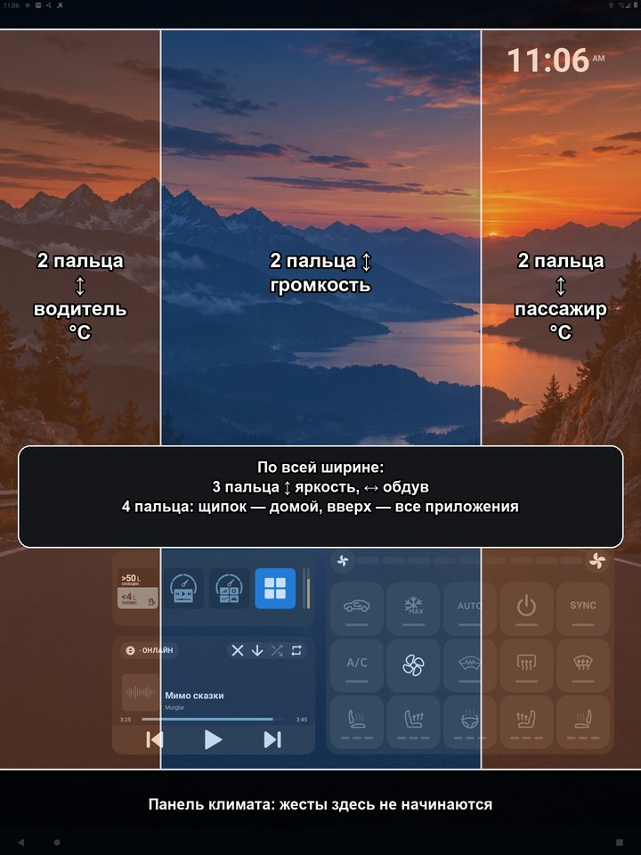
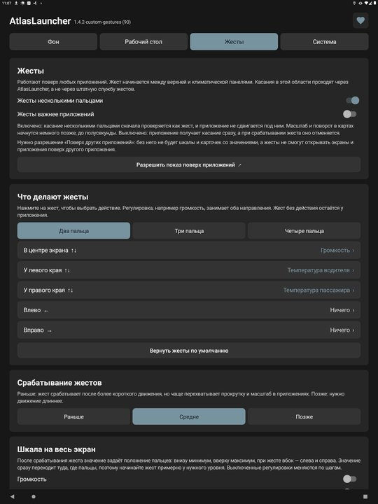
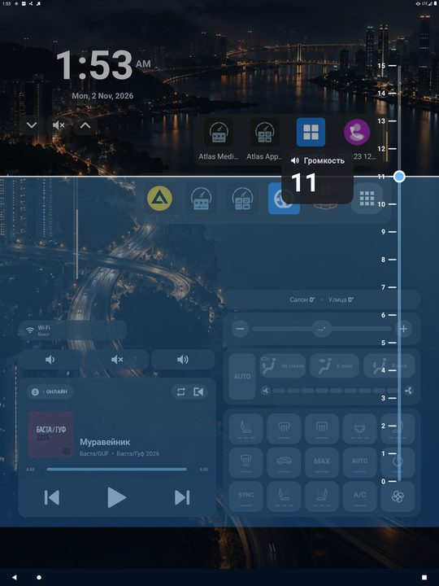
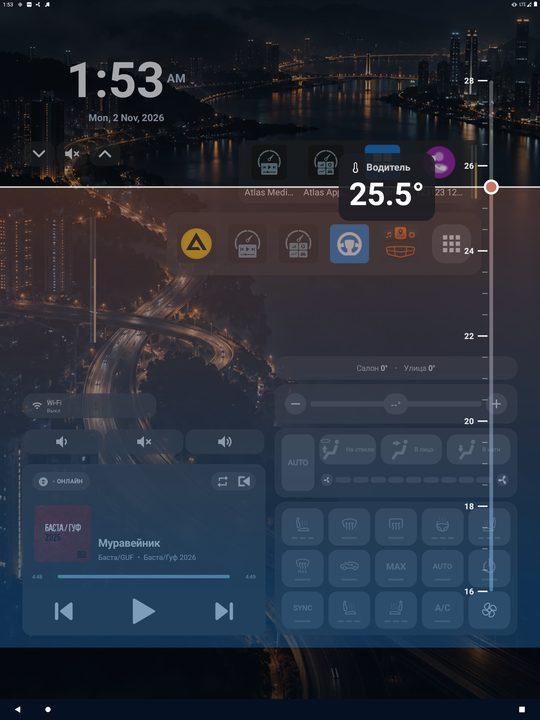
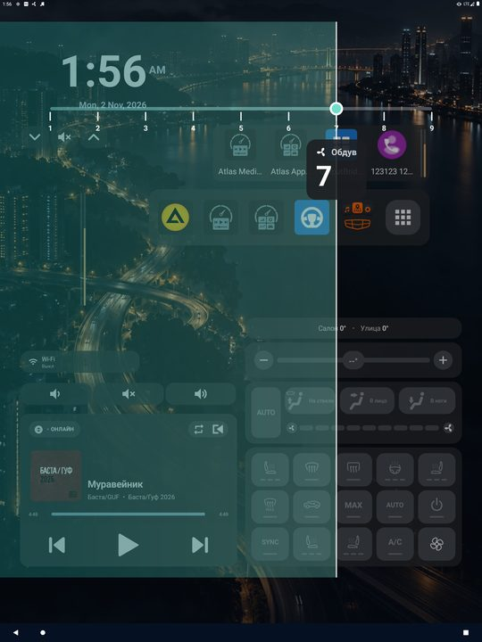
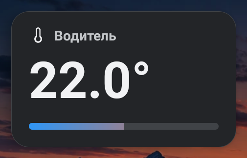
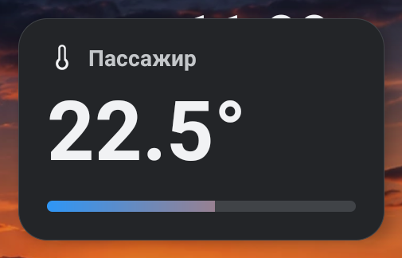
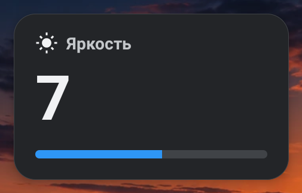
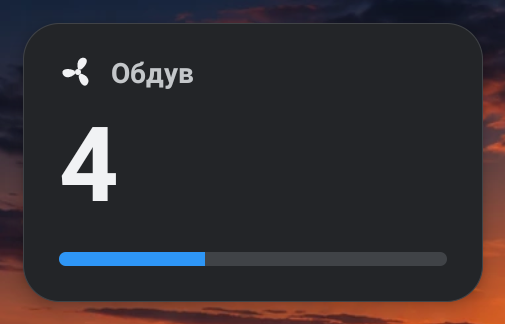
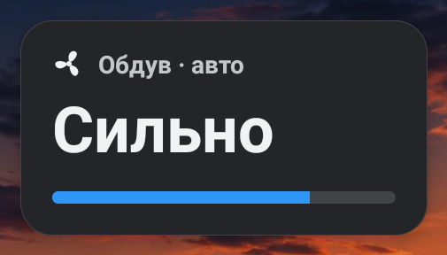

# Жесты

AtlasLauncher распознаёт жесты двумя, тремя и четырьмя пальцами в любом приложении, не только на рабочем столе. Что делает каждый жест, выбираете вы: регулировку, системное действие, музыку, климат или запуск приложения. По умолчанию функция выключена.

## Что нужно

- **ГУ OneOS** со службой `EcarxInputDispatcherService`: через неё AtlasLauncher получает касания поверх других приложений. На обычном Android, в том числе на эмуляторе, служба жестов запускается, но касаний не получает.
- **Разрешение «Поверх других приложений»** — для шкалы и карточек со значениями, а также для действий, открывающих что-либо поверх другого приложения.
- **GInputBridge не обязателен.** Температуре, яркости, обдуву и переключателям климата нужен доступ к автомобилю: его даёт GInputBridge либо сам AtlasLauncher (см. [«Управление автомобилем»](#управление-автомобилем)).

Включение: долгое нажатие на свободное место рабочего стола → `⚙` → вкладка «Жесты» → «Жесты несколькими пальцами». Пока жесты включены, в шторке висит уведомление «Жесты включены»: служба работает в отдельном процессе и не зависит от рабочего стола.

## Где работают жесты

Жест должен начаться между верхней строкой состояния и климатической панелью. Начатое в этих полосах касание остаётся у SystemUI. Внутри области все касания сначала проходят через AtlasLauncher, а не через штатную службу жестов OneOS.

Для двух пальцев вверх и вниз экран делится на три полосы: левая четверть, середина и правая четверть. Оба пальца должны стоять в одной полосе. Остальные жесты работают по всей ширине.

## Настройка жестов

На вкладке «Жесты» в карточке «Что делают жесты» выберите число пальцев: ниже появятся его жесты, справа от каждого — действие. Регулировка занимает одну строку на оба направления (↑↓ или ←→), а разовые действия — по строке на направление. Нажмите на жест и выберите действие; «Вернуть жесты по умолчанию» отменяет все изменения.

| Пальцы | Жесты | По умолчанию |
|---|---|---|
| 2 | вверх и вниз в центре | громкость |
| 2 | вверх и вниз у левого края | температура водителя |
| 2 | вверх и вниз у правого края | температура пассажира |
| 2 | влево, вправо | ничего |
| 3 | вверх и вниз | яркость |
| 3 | влево и вправо | обдув |
| 3 | касание | ничего |
| 4 и больше | вверх | «Все приложения» |
| 4 и больше | вниз, влево, вправо | ничего |
| 4 и больше | свести пальцы | главный экран |
| 4 и больше | развести пальцы | ничего |
| 4 и больше | касание | ничего |

Что можно выбрать:

- **Регулировка**: громкость, температура водителя или пассажира, яркость, обдув. Регулировка занимает оба направления жеста и меняет значение, пока пальцы двигаются; с четырьмя пальцами недоступна.
- **Система**: главный экран, назад, все приложения, недавние приложения, снимок экрана, Wi-Fi и Bluetooth вкл/выкл.
- **Музыка**: пауза и продолжение, следующий и предыдущий трек, выключить звук. Пауза и переключение треков работают через [Atlas Media Widget](https://github.com/mmwtl/AtlasMediaWidget): он должен быть установлен и запущен, иначе эти жесты ничего не делают.
- **Климат**: экран климата, скрыть панель климата, климат, AUTO, кондиционер, рециркуляция, обдув лобового стекла и обогрев заднего стекла вкл/выкл.
- **Приложение**: любое из каталога.
- **Activity**: отдельный экран приложения, например раздел настроек. Выберите приложение и его Activity из списка — в нём есть и приложения без значка в каталоге — или укажите `пакет/.Activity` вручную. Подходят только Activity, которые приложение разрешает открывать извне.

Разовое действие срабатывает один раз за касание. Если выбрать его на одном направлении там, где стояла регулировка, второе направление станет «Ничего», и ему можно назначить своё действие.

**Жест без действия остаётся у приложения:** AtlasLauncher его не распознаёт. Поэтому карты, например, не теряют сдвиг двумя пальцами вбок, пока он не назначен.

## Шкала на весь экран

| Громкость | Температура | Обдув |
|---|---|---|
|  |  |  |

Включается отдельно для громкости, температуры, яркости и обдува; по умолчанию всё выключено, и выключенные регулировки меняются по шагам. Жест срабатывает так же, по порогу из «Срабатывания жестов», но дальше значение задаёт положение пальцев, а не пройденное расстояние: область между верхней и климатической панелями — это шкала от минимума внизу до максимума вверху, у жеста вбок — от минимума слева до максимума справа. В 150 px от края шкалы уже минимум или максимум. Громкость идёт от 0 до максимума, температура — от 16 до 28 °C с шагом 0,5, яркость — в пределах, которые сообщает автомобиль, обдув — скорости 1–9 или профили авто-обдува.

Значение сразу переходит туда, где находятся пальцы, поэтому начинайте жест примерно у нужного уровня. Пока пальцы на экране, движение поперёк или изменение расстояния между ними жест не прерывают.

Пока пальцы на экране, поверх всего рисуется полупрозрачная шкала: подкрашенная часть экрана заканчивается под пальцами, у края с другой стороны от них идут деления, которые вытягиваются возле пальцев, а рядом крупно показано текущее значение. Шкала не мешает касаниям и исчезает с последним пальцем. Её можно отключить переключателем «Рисовать шкалу поверх экрана» — тогда, как и без разрешения «Поверх других приложений», громкость показывает штатный индикатор OneOS, а остальное — карточка.

## Карточки

Карточка появляется при каждом шаге регулировки и исчезает через полторы секунды. Температура показывается у своего края, яркость и обдув — посередине. На пределе диапазона карточка тоже появляется, чтобы было видно, почему значение не меняется. Переключатели климата, Wi-Fi и Bluetooth показывают новое состояние такой же карточкой без полосы. Если состояние переключателя климата ещё не получено от машины, жест ничего не переключает, а карточка пишет «Нет данных» — повторите жест через секунду. «Без звука» показывает, включён ли звук после жеста. Медиакоманды показывают значок и то, что Atlas Media Widget отправил источнику: «Пуск», «Пауза», «Далее» или «Назад». Если виджет команду не принял (его служба не запущена, источник не подключён или не умеет эту команду), карточка пишет «Недоступно».

| Водитель | Пассажир | Яркость |
|---|---|---|
|  |  |  |

| Обдув | Обдув в режиме AUTO |
|---|---|
|  |  |

Один шаг регулировки: громкость и температура — 60 px (громкость не больше трёх делений за раз, температура по 0,5 °C), яркость — 70 px, обдув — 80 px. Первый шаг требует чуть большего хода, чем следующие (см. [«Срабатывание жестов»](#срабатывание-жестов)).

В климатическом режиме AUTO автомобиль не принимает ручную скорость вентилятора, поэтому обдув переключает профиль авто-обдува: Тихо, Мягко, Комфорт, Сильно, Макс — так же, как AtlasClimateWidget.

## Как отличается жест от обычного касания

- **Все пальцы движутся в одну сторону и сохраняют расстояние между собой.** Масштаб и поворот двумя пальцами в картах, а также масштаб с одним неподвижным пальцем остаются приложению.
- **Ось выбирается первым шагом.** Если три пальца начали менять яркость, движение вбок уже не меняет обдув, и наоборот. Движение в основном поперёк оси жестом не считается.
- **Сначала пальцы должны опуститься.** Пальцы касаются экрана не одновременно, поэтому жест двумя или тремя пальцами ждёт 200 мс после изменения числа пальцев. Движение за это время не теряется, а учитывается после паузы. Четырём пальцам пауза не нужна: их не с чем спутать.
- **Одно касание — один жест, по наибольшему числу пальцев.** Если третий палец опустился, касание уже не станет жестом двумя пальцами. После сработавшего жеста оставшиеся пальцы ничего не делают, пока все не будут подняты. Пятый палец не сбрасывает уже начатый жест четырьмя пальцами.
- **Касание несколькими пальцами** — все пальцы опустились и поднялись меньше чем за 0,4 с, ни один не сдвинулся больше чем на 30 px.

## Настройки

### Жесты важнее приложений

- **Выключено** (по умолчанию). Приложение получает касание сразу. Когда жест срабатывает, приложению приходит отмена касания, и до отпускания пальцев оно касаний больше не получает. Карта может немного сдвинуться до срабатывания.
- **Включено.** Касание несколькими пальцами сначала проверяется как жест, и приложение под ним не двигается. Если касание жестом не оказалось, приложение получает его с задержкой — не больше полусекунды. Из-за этого масштаб и поворот в картах начинаются чуть позже.

### Срабатывание жестов

Сколько нужно сдвинуть пальцы, прежде чем жест сработает в первый раз. Следующие шаги и пауза на опускание пальцев от этой настройки не зависят.

| | Раньше | Средне (по умолчанию) | Позже |
|---|---|---|---|
| Первый шаг регулировки | 1 шаг: 60 / 70 / 80 px | 1,25 шага: 75 / 88 / 100 px | 1,5 шага: 90 / 105 / 120 px |
| Свайп с разовым действием | 120 px | 150 px | 180 px |
| Свести или развести четыре пальца | на 20 % | на 25 % | на 40 % |

В строке первого шага указаны громкость и температура / яркость / обдув. «Раньше» удобнее, но чаще перехватывает прокрутку и масштаб в приложениях, особенно когда «Жесты важнее приложений» выключено.

### Управление автомобилем

Переключатель «Работать без GInputBridge»: температура, яркость, обдув и переключатели климата идут напрямую через функции ГУ, а не через GInputBridge. Если GInputBridge не установлен, режим включён сам. На устройстве без этих функций останется GInputBridge. Громкость, музыка, системные действия и запуск приложений от выбора не зависят.

## Ограничения

- Расстояния заданы в физических пикселях экрана ГУ 1440×1920. На экране другого размера служба не включается.
- Распознавание проверено JVM-тестами, настройка и действия — на эмуляторе с заменой службы OneOS на подставную с тем же протоколом ([tools/gesture-standin](../../tools/gesture-standin/README.md)). **На ГУ не проверены:** прямое управление автомобилем, «Назад» и снимок экрана (клавиши через фильтр касаний), недавние приложения, экран климата и его переключатели, шкала поверх экрана, а также установка громкости сразу на уровень в OneOS.
- «Снимок экрана» работает, только если OneOS обрабатывает системную клавишу снимка. Открытие шторки клавишей на ГУ не сработало, поэтому этого действия больше нет; жест, которому оно было назначено, возвращается к значению по умолчанию.
- Свайп от края экрана OneOS превращает в «Назад»; жесты, начатые у самого края, на ГУ не проверялись.
- Без разрешения «Поверх других приложений» не показываются шкала и карточки, а действия не открывают экраны и приложения поверх другого приложения.
